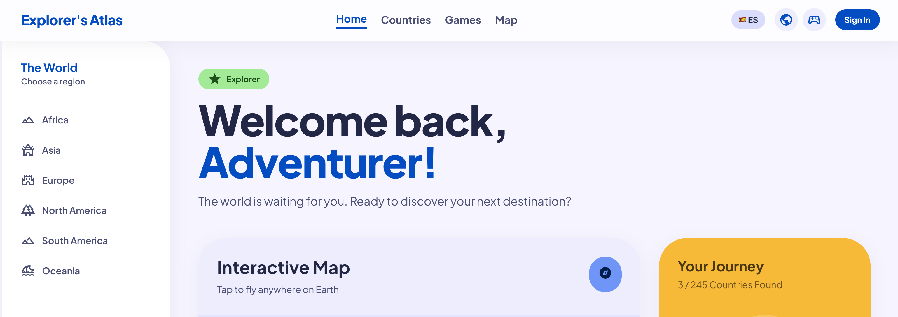
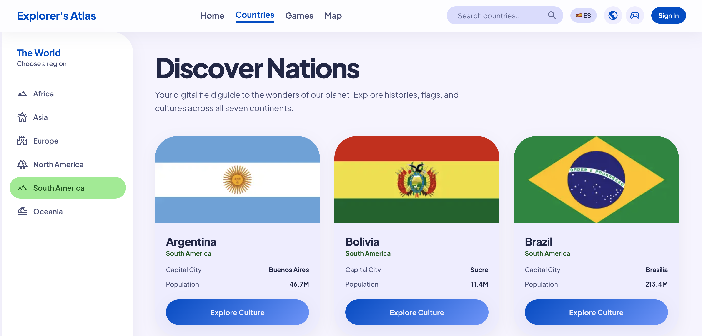
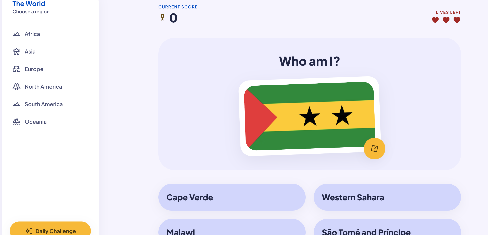

# 🌍 Explorer's Atlas

**Explore every nation on Earth. Learn their flags. Test your knowledge.**

Explorer's Atlas is an interactive geography app covering all **245 countries and territories** across 7 continents. Discover cultures, play flag quizzes, track your progress, and challenge yourself — all in English or Spanish.

**🔗 Live site: [fun-with-flags-six.vercel.app](https://fun-with-flags-six.vercel.app/)**



---

## ✨ Features

- **🗺️ Countries Catalog** — Browse all 245 nations with flags, capitals, populations and continents. Filter by region, or search by name.
- **🎮 Flag Quiz** — See a flag, pick the right country from 4 options. 3 lives, score tracking, and a Daily Challenge mode to keep you coming back.
- **📈 Personal Journey** — Your progress is saved automatically. See how many countries you've discovered and your quiz high score.
- **🔐 Sign In with Google** — One click to save your progress across devices and sessions.
- **🌐 Bilingual** — Full English and Spanish interface (EN / ES).
- **👤 No account required** — Start exploring instantly as a guest; sign in whenever you're ready.

---

## 📸 Screenshots

### Dashboard


### Countries Catalog


### Flag Quiz


---

## 🚀 Getting Started

### Prerequisites

- Node.js 22+
- A Firebase project (free tier is enough)

### Install & run

```bash
git clone https://github.com/fonseka-dev/fun-with-flags.git
cd fun-with-flags
npm install
cp .env.local.example .env.local   # then fill in your Firebase credentials
npm run dev
```

Open [http://localhost:3000](http://localhost:3000).

---

## 🔥 Firebase Setup

The app uses Firebase for anonymous sessions, Google Sign-In, and progress persistence via Firestore. Follow the step-by-step guide:

> 1. Create a Firebase project at [console.firebase.google.com](https://console.firebase.google.com)
> 2. Enable **Anonymous Authentication** and **Google Sign-In**
> 3. Create a **Firestore** database
> 4. Copy your config into `.env.local` using the variables in `.env.local.example`

The app works without Firebase — sign-in and progress tracking will simply be inactive.

---

## 🧪 Running Tests

```bash
npm test
```

Vitest tests cover auth flows, country data, quiz logic, and the SEO contract.

### SEO and social cards

The confirmed public origin is `https://fun-with-flags-six.vercel.app`. `/` redirects to the locale route; `/en` and `/es` are canonical. Public pages are the home, catalog, map, flag game, rankings, and every country detail in both languages. `/en/onboarding` and `/es/onboarding` are `noindex` and excluded from the sitemap. Preview builds also render `noindex` in HTML using `VERCEL_ENV=preview`; Vercel normally adds an `X-Robots-Tag: noindex` header. Check that header after deployment, particularly if a custom domain is assigned to a preview.

Titles, descriptions, canonical URLs, language alternatives, and social image URLs come from `src/lib/seo.ts`. Update `SITE_ORIGIN` there if the production domain changes, then regenerate and check the site. Route-specific country titles and descriptions are built from the translations in `src/data/countries.ts`. `src/app/sitemap.ts` and `src/app/robots.ts` use the same origin and route list.

The approved blue card uses the product icon, Jorge's portrait in `design/social-card/profile_1.png`, and the JF mark in `design/social-card/jf-favicon.svg`. Final cards are `public/social/explorers-atlas-en.png` and `public/social/explorers-atlas-es.png` (1200 × 630). To change the portrait or text, edit the source assets or `scripts/generate-social-cards.py`, then regenerate on macOS with Pillow and the installed Node dependencies:

```bash
python3 scripts/generate-social-cards.py
```

The generator uses the system Avenir Next font and `sharp` from the existing Next.js dependencies; it does not fetch assets at render time. The card is a static image when shared. For a full local check, run:

```bash
npm test
npm run build
PORT=3100 npm run start
# In a second terminal:
SEO_BASE_URL=http://127.0.0.1:3100 npm run check:seo
```

The GET check reads all 500 public HTML pages without JavaScript, plus `robots.txt`, `sitemap.xml`, the two PNGs, and both onboarding pages. Country detail body content and some interactive views load in the client with Firebase; metadata in initial HTML does not make that body content available without JavaScript. Local checks cannot prove search indexing, ranking, or when social platforms refresh cached cards. After an authorized deploy, check the public URLs and `X-Robots-Tag` headers separately.

---

## 🛠️ Tech Stack

| Layer | Technology |
|---|---|
| Framework | Next.js 16 (App Router) |
| Language | TypeScript |
| Styling | Tailwind CSS |
| Auth & DB | Firebase (Anonymous Auth, Google Sign-In, Firestore) |
| i18n | next-intl (EN / ES) |
| Testing | Vitest |
| Hosting | Vercel |

---

## 📁 Project Structure

```
src/
├── app/              # Next.js App Router pages
├── components/       # Reusable UI components
├── lib/              # Firebase client, auth provider, helpers
└── messages/         # i18n translation files (en.json, es.json)
scripts/              # Country data seeding scripts
public/               # Static assets
```

---

## 🤝 Contributing

Contributions are welcome! To get started:

1. Fork the repo
2. Create a feature branch: `git checkout -b feat/your-feature`
3. Commit using [Conventional Commits](https://www.conventionalcommits.org/): `feat(quiz): add timer mode`
4. Push and open a Pull Request

---

## 📄 License

Licensed under the [Apache License 2.0](LICENSE).

